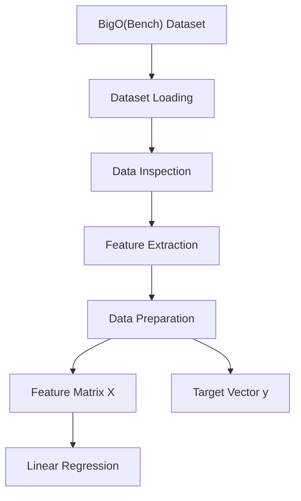

# Predicting Software Execution Time Using Code Complexity Metrics

AI101 Final Project

A regression-based research project exploring the relationship between source code complexity and software execution time using Linear Regression and the BigO(Bench) dataset.

---

## Table of Contents

- [Project Overview](#project-overview)
- [Problem Statement](#problem-statement)
- [Research Objectives](#research-objectives)
- [Dataset](#dataset)
- [Technical Stack](#technical-stack)
- [System Workflow](#system-workflow)
- [Mathematical Foundation](#mathematical-foundation)
- [Model Evaluation](#model-evaluation)
- [Functional Requirements](#functional-requirements)
- [Non-Functional Requirements](#non-functional-requirements)
- [Limitations](#limitations)
- [Repository Structure](#repository-structure)
- [Google Colab Workflow](#google-colab-workflow)
- [Research Team](#research-team)
- [References](#references)
- [Project Status](#project-status)

---

## Project Overview

Software performance is an important consideration in software development. Understanding how long a program takes to execute helps developers evaluate performance, identify potential bottlenecks, and make informed decisions when improving their code.

This project investigates whether measurable characteristics of source code can be used to estimate software execution time through a mathematical regression model.

The study uses **Linear Regression**, with code complexity metrics as independent variables and execution time as the intended dependent variable.

The project also demonstrates the application of Linear Algebra in Machine Learning, particularly in representing datasets as matrices, calculating regression coefficients, and evaluating model predictions.

## Problem Statement

Developers often need to estimate the execution time of a program before or during performance evaluation. However, execution time is influenced by several factors, including source code structure, algorithm efficiency, input size, and the computing environment.

This project aims to investigate the following question:

> Can measurable code complexity metrics help predict the execution time of a software program using a Linear Regression model?

## Research Objectives

- Identify measurable characteristics of source code that may influence execution time.
- Explore the relationship between code complexity metrics and software performance.
- Apply Linear Regression to estimate execution time.
- Demonstrate the mathematical foundation of regression using Linear Algebra.
- Evaluate the model using appropriate regression evaluation metrics.

## Dataset

### BigO(Bench)

The project uses **BigO(Bench)**, an open dataset available through Hugging Face.

| Information | Details |
|---|---|
| Dataset Name | BigO(Bench) |
| Provider | Facebook / Meta AI researchers |
| Platform | Hugging Face |
| Dataset Link | [BigO(Bench on Hugging Face](https://huggingface.co/datasets/facebook/BigOBench) |
| Selected Configuration | `time_complexity_test_set.jsonl` |
| Selected Samples | 640 |
| Current Feature Count | 1 |
| Current Feature | `Code_Length` |

### Dataset Description

BigO(Bench) contains Python code solutions, inferred time-complexity labels, and runtime-related information.

For the initial notebook implementation, the selected dataset configuration is used to extract source-code length as a numerical feature.

**Current implementation:**

| Variable | Description |
|---|---|
| X (Feature Matrix) | Source-code length |
| y (Target Vector) | `time_curve_coefficient` |
| n (Samples) | 640 |
| p (Features) | 1 |

The current implementation predicts the numerical runtime-curve coefficient, not actual execution time in seconds.

The intended research model and current notebook implementation are distinguished until dataset preparation and target selection are finalized.

## Technical Stack

| Technology | Purpose |
|---|---|
| Python | Primary programming language |
| Google Colab | Development and experimentation environment |
| NumPy | Numerical computations and matrix operations |
| Pandas | Dataset manipulation and preparation |
| Hugging Face Datasets | Loading the BigO(Bench) dataset |
| Scikit-learn | Regression modeling and evaluation |
| Matplotlib | Data visualization |

## System Workflow

The project follows a structured Machine Learning workflow.



### Workflow Description

1. **Dataset Loading:** Retrieve the selected BigO(Bench) configuration from Hugging Face.
2. **Data Inspection:** Examine the available columns, records, and data types.
3. **Feature Extraction:** Extract numerical characteristics from the source code.
4. **Data Preparation:** Organize the independent and dependent variables.
5. **Matrix Representation:** Represent the input features as matrix `X` and the target as vector `y`.
6. **Model Training:** Apply Linear Regression to learn the relationship between the selected variables.
7. **Prediction:** Generate predictions using the trained model.
8. **Evaluation:** Compare predicted values against actual target values.
9. **Analysis:** Interpret the model's performance and identify limitations.

## Mathematical Foundation

The project demonstrates the relationship between Linear Algebra and Machine Learning.

### Matrix Representation

The independent variables are represented by a feature matrix:

$$
X =
\begin{bmatrix}
x_{11} & x_{12} \\
x_{21} & x_{22} \\
\vdots & \vdots \\
x_{n1} & x_{n2}
\end{bmatrix}
$$

The dependent variable is represented by a column vector:

$$
y =
\begin{bmatrix}
y_1 \\
y_2 \\
\vdots \\
y_n
\end{bmatrix}
$$

Where:

- `n` represents the number of program samples.
- `p` represents the number of independent variables.
- `X` represents the feature matrix.
- `y` represents the target vector.

### Multiple Linear Regression

The intended regression model is:

$$
\hat{T} = b_0 + b_1(LOC) + b_2(CC)
$$

Where:

- `T̂` = Predicted execution time in seconds.
- `b₀` = Intercept.
- `b₁` = Regression coefficient for LOC.
- `b₂` = Regression coefficient for CC.
- `LOC` = Lines of Code.
- `CC` = Cyclomatic Complexity.

### Ordinary Least Squares

The regression coefficients can be estimated using the Normal Equation:

$$
\hat{\beta} = (X^TX)^{-1}X^Ty
$$

This formulation applies when the inverse exists. Other numerical approaches, such as the Moore-Penrose pseudoinverse, can be used when necessary.

The objective is to minimize the sum of squared differences between actual and predicted values.

## Model Evaluation

The model will be evaluated using standard regression metrics.

| Metric | Description |
|---|---|
| Mean Absolute Error (MAE) | Measures the average absolute prediction error. |
| Mean Squared Error (MSE) | Measures the average squared prediction error. |
| Root Mean Squared Error (RMSE) | Measures prediction error while penalizing larger errors. |
| R-squared (R²) | Measures how much variation in the target is explained by the model. |

Evaluation should use test samples that were not used during model training.

For execution-time prediction, MAE and RMSE should be interpreted in seconds.

## Functional Requirements

| ID | Requirement | Description |
|---|---|---|
| FR-01 | Dataset Loading | The system must load the selected dataset. |
| FR-02 | Data Inspection | The system must display dataset dimensions and available columns. |
| FR-03 | Feature Extraction | The system must extract numerical code characteristics. |
| FR-04 | Data Preparation | The system must organize features and target values. |
| FR-05 | Matrix Representation | The system must represent the dataset using appropriate matrix and vector structures. |
| FR-06 | Model Training | The system must train a Linear Regression model. |
| FR-07 | Prediction | The system must generate predictions for unseen samples. |
| FR-08 | Model Evaluation | The system must calculate regression evaluation metrics. |
| FR-09 | Result Interpretation | The system must present and interpret the model results. |

## Non-Functional Requirements

- **Reproducibility:** The notebook should produce consistent results when executed with the same dataset and configuration.
- **Usability:** The implementation should be understandable and executable in Google Colab.
- **Maintainability:** Code should follow a simple and organized structure.
- **Data Integrity:** Missing or invalid records should be handled appropriately.
- **Transparency:** Dataset sources, feature definitions, model assumptions, and limitations should be documented.
- **Performance:** Dataset processing and model training should be practical within the available computing environment.

## Limitations

The project recognizes that source-code complexity alone cannot fully determine software execution time.

Actual execution time may also depend on:

- Input size and input characteristics.
- Algorithm design and implementation.
- Processor and memory capabilities.
- Operating system and software environment.
- Compiler and interpreter behavior.
- External operations such as file access and network requests.

Additionally, Big-O time complexity and Cyclomatic Complexity represent different concepts.

Big-O describes how algorithmic work grows with input size, while Cyclomatic Complexity describes the number of linearly independent execution paths.

The model's predictions should therefore be treated as estimates rather than guaranteed execution times.

## Repository Structure

```text
runtime-prediction/
├── README.md
├── notebooks/
│   ├── Part_A_Problem_and_Dataset.ipynb
│   ├── Part_B_Matrices.ipynb
│   ├── Part_C_Vector_Spaces.ipynb
│   ├── Part_D_Linear_Transformations.ipynb
│   ├── Part_E_Determinants.ipynb
│   ├── Part_F_Eigenvalues_Eigenvectors.ipynb
│   ├── Part_G_Diagonalization.ipynb
│   └── Part_H_Regression_Model.ipynb
├── data/
└── docs/
```

The `docs/` folder is reserved for the research paper and related documentation. Dataset files and intermediate `.npz` files are used through Google Drive rather than committed unnecessarily to the repository.

## Google Colab Workflow

No local installation is required. Open the notebooks in Google Colab and run them in order.

### Execution order

Run the notebooks from Part A through Part H:

- Part A prepares the dataset and saves the initial data.
- Part B loads Part A's data, performs matrix operations, and saves its results.
- Part C loads the previous data, calculates vector-space properties, and saves its results.
- Part D loads the earlier data, applies the transformation, splits the data, and saves the train/test arrays.
- Part E loads Part D's training data and saves the determinant-related results.
- Part F loads Part D's data, computes eigenvalues and eigenvectors, and saves `part_f_data.npz`.
- Part G loads Part F's eigenpairs, performs diagonalization/PCA projection, and saves the projected data.
- Part H loads the prepared data from Parts D and G, then trains and evaluates the regression models.

### Saving and loading between notebooks

Each notebook must be run completely before opening the next one. At the beginning of each part, the notebook loads data saved by an earlier part from Google Drive. At the end, it saves the variables needed by the next notebook as an `.npz` file in:

```text
/content/drive/MyDrive/
```

For example, Part F loads `part_d_data.npz` and saves `part_f_data.npz`; Part G then loads `part_f_data.npz`. Keep the same Google account and Drive location throughout the workflow.

### Running a notebook in Colab

1. Open or upload the required notebook in Google Colab.
2. Run the cells from top to bottom.
3. Authorize Google Drive access when prompted.
4. Confirm the save-success message before continuing to the next part.

The notebooks are designed for the Colab environment and are not documented as local scripts or as a locally installed Python package.

## Research Team

| Name |
|---|
| Mary Yvonne Carandang |
| Kelsey Leigh Cebrero |
| John Elvin Endrenal |
| Mark Joseph Holgado |
| Rolan Kian Sacopon |

## References

1. BigO(Bench). (n.d.). *BigO(Bench) dataset*. Hugging Face. https://huggingface.co/datasets/facebook/BigOBench

2. Radon. (n.d.). *Radon: Python tool for code metrics*. https://radon.readthedocs.io/

3. Scikit-learn. (n.d.). *LinearRegression*. https://scikit-learn.org/stable/modules/generated/sklearn.linear_model.LinearRegression.html

4. NumPy. (n.d.). *NumPy documentation*. https://numpy.org/doc/

## Project Status

**Current Stage:** Initial dataset preparation and feature selection.

The initial implementation loads the BigO(Bench) dataset and prepares a numerical feature matrix using source-code length.

Further development is required to align the dataset's target with the research objective of predicting actual execution time in seconds.

The remaining work includes:

- Finalizing the runtime measurement data.
- Implementing the intended LOC and Cyclomatic Complexity features.
- Training the regression model.
- Evaluating predictive performance.
- Interpreting and documenting the results.

---

**Project:** [code-runtime-predictor](https://drive.google.com/drive/folders/1zRnaAc_q1OHg67PCBia9eKju5-B0XbPX?usp=drive_link)

**Research Focus:** Applying Linear Algebra and Regression Analysis to Software Performance Prediction.
